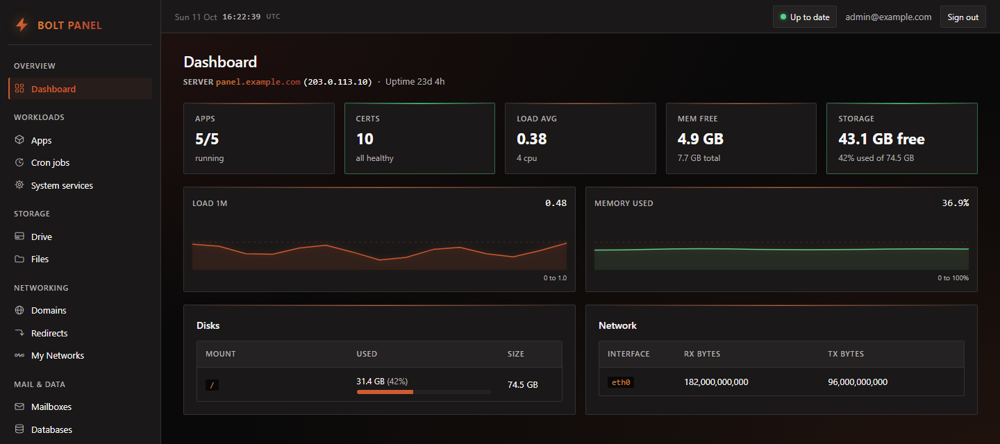
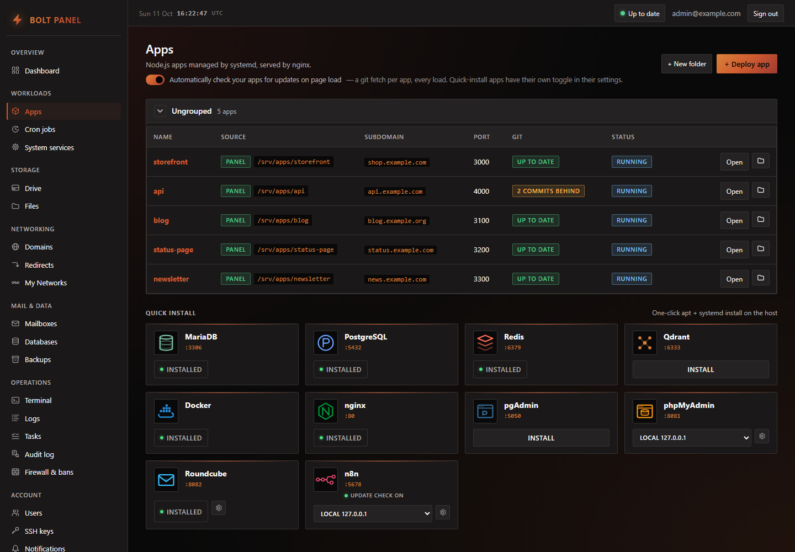
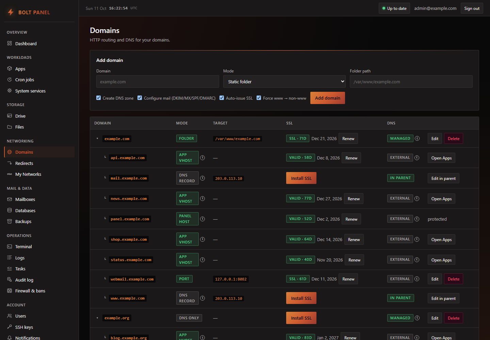
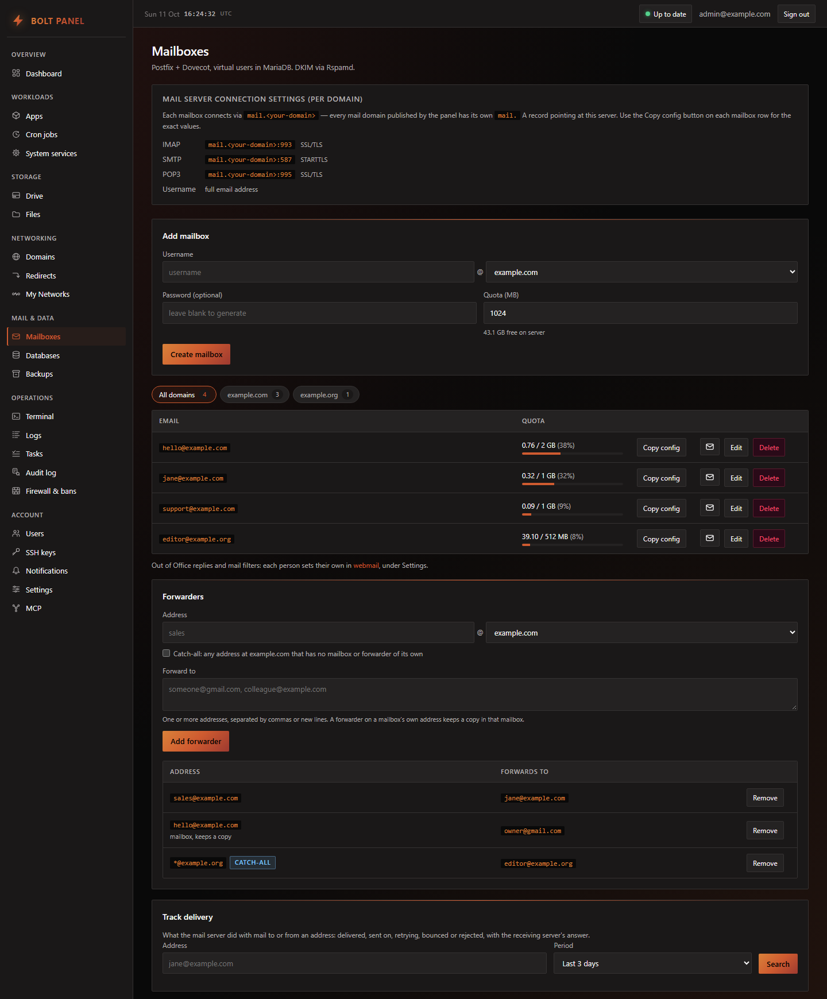
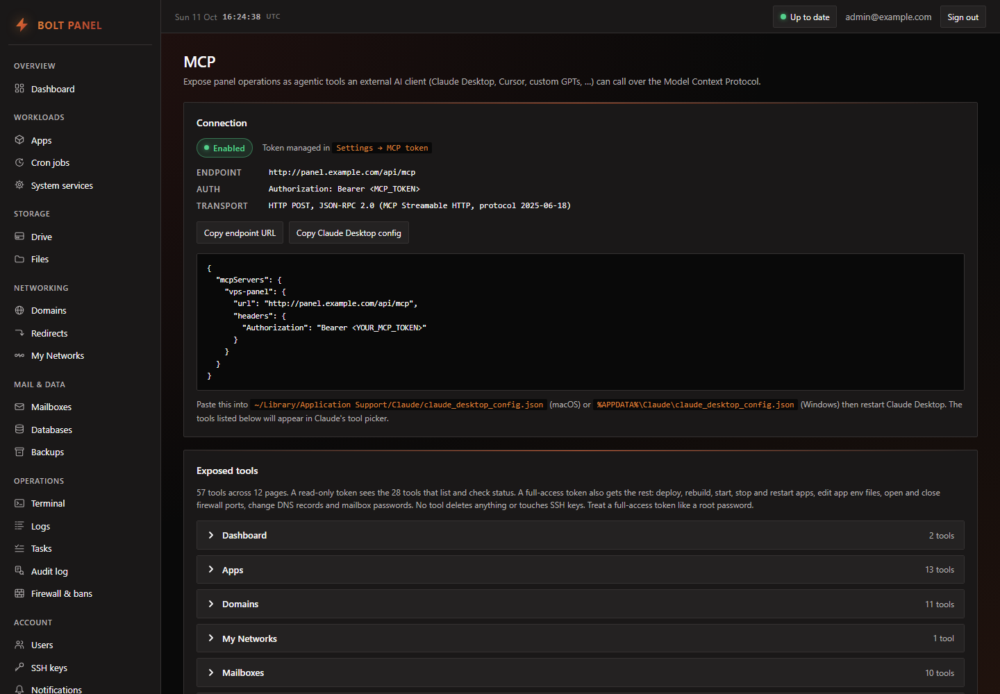
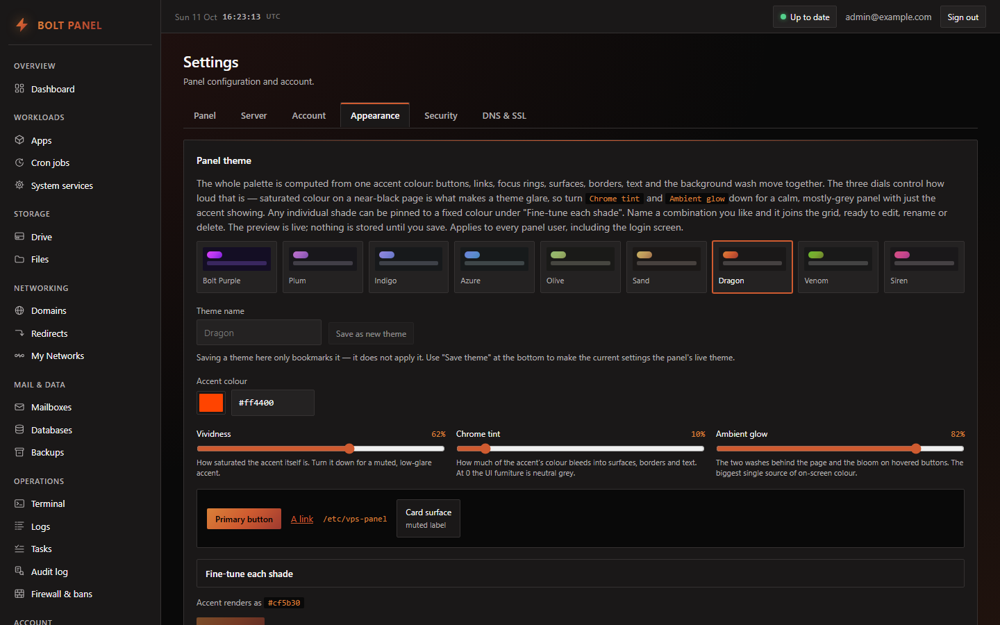

# Bolt Panel

**A free, self-hosted cPanel alternative for your own Ubuntu VPS.** Deploy Node.js apps from Git, run your domains, SSL, DNS and email with webmail, and manage databases and backups from one fast panel. Point Claude or any other MCP client at it and let an AI agent do the clicking.

[](LICENSE)


[](https://github.com/Meliorate-agency/vps-panel/stargazers)



## Why Bolt Panel

- **Free and open source.** AGPL-3.0, no per-account licence, no telemetry.
- **Light.** nginx, a Rust agent and a Next.js UI. No Apache/PHP stack to babysit; a 2 GB VPS is enough.
- **Git to running app in one form.** Each app gets a hardened systemd service, an nginx vhost and a Let's Encrypt cert, with "update available" badges and one-click updates.
- **Your own mail server, done right.** Postfix, Dovecot and Rspamd with DKIM, SPF and DMARC published for you, Roundcube webmail, forwarders, catch-alls and delivery tracking.
- **AI-ready.** A built-in MCP server exposes 50+ tools to Claude Desktop, Cursor or your own agent, with read-only or full-access tokens and an audit log of every call.
- **Safe by design.** The UI never runs as root: a small Rust agent does privileged work over a Unix socket. The installer hardens the OS (ufw, fail2ban, AppArmor, unattended-upgrades, SSH, sysctl).

## Features

- **Apps:** deploy Node.js apps from Git or a folder, start/stop/restart, environment files, update checks, folders to group them.
- **Domains and DNS:** nginx sites (reverse proxy to a port, static folder, redirects), authoritative DNS with PowerDNS, one-click DNSSEC.
- **SSL:** in-process ACME (Let's Encrypt), automatic renewal.
- **Mail:** virtual mailboxes with quotas, DKIM signing, forwarders and catch-alls, delivery tracking, Roundcube webmail where each person sets their own filters and Out of Office.
- **Databases:** MariaDB and PostgreSQL users, databases and grants, SQL dump import, phpMyAdmin and pgAdmin.
- **One-click installs:** Docker, Redis, Qdrant, n8n, phpMyAdmin, pgAdmin, Roundcube, Tailscale.
- **Operations:** encrypted, deduplicated backups with restic, cron jobs, live logs, a web terminal, task progress, audit log, health charts, email and webhook notifications.
- **Security:** firewall and fail2ban bans from the UI, SSH keys and sshd settings, TOTP two-factor login, panel IP allowlist, admin and user roles.
- **My Networks:** link several servers and see their status in one panel.
- **Themes:** nine built-in colour themes or your own, and the panel updates itself from GitHub.

## Screenshots

<table>
  <tr>
    <td><a href="docs/screenshots/apps.png"></a><br><sub><b>Apps</b>: Git deploys, update badges and one-click installs</sub></td>
    <td><a href="docs/screenshots/domains.png"></a><br><sub><b>Domains</b>: routing, SSL and DNS in one table</sub></td>
  </tr>
  <tr>
    <td><a href="docs/screenshots/mailboxes.png"></a><br><sub><b>Mail</b>: mailboxes, forwarders, catch-alls and delivery tracking</sub></td>
    <td><a href="docs/screenshots/mcp.png"></a><br><sub><b>MCP</b>: connect Claude or any MCP client in one paste</sub></td>
  </tr>
  <tr>
    <td colspan="2"><a href="docs/screenshots/themes.png"></a><br><sub><b>Themes</b>: shown here in Dragon, one of nine presets</sub></td>
  </tr>
</table>

## Bolt Panel or cPanel?

| | Bolt Panel | cPanel |
|---|---|---|
| Price | Free, open source | Paid licence per account |
| Built for | One owner running their own apps, mail and DNS | Hosting many separate customer accounts |
| Stack | nginx, Rust agent, Next.js | Apache, PHP, Exim |
| Deploying apps | Node.js from Git, one form | PHP first; Node via Passenger |
| AI agents | Built-in MCP server | Classic APIs |
| Several servers | One view (My Networks) | One WHM per server |
| PHP / WordPress | Not supported | Yes |
| Resellers, customer accounts | Not supported | Yes |

## Install

On a fresh Ubuntu 24.04 server, as root:

```bash
git clone https://github.com/Meliorate-agency/vps-panel.git /root/vps-panel-src
bash /root/vps-panel-src/scripts/install.sh --domain panel.example.com --email you@example.com
```

The script installs everything, generates secrets, creates system users, brings up the agent and the panel, and prints the bootstrap admin credentials. Leave out `--domain` / `--email` to be asked, or to install in IP-only mode. Step by step: [FIRST_INSTALL.md](FIRST_INSTALL.md). Updates, uninstall and recovery: [docs/DEPLOY.md](docs/DEPLOY.md). Threat model and hardening: [docs/SECURITY.md](docs/SECURITY.md).

## Develop

For local development on a workstation (no system mutations, no privileged paths):

- `npm install`
- `npm run dev`  - panel on `http://localhost:10000`
- `cargo check --manifest-path agent/Cargo.toml` - the agent will only fully build/run on Linux because of UnixListener and `nix` requirements.

## Out of scope

PHP hosting, containerised app deploys, multi-server orchestration.

## License

[AGPL-3.0](LICENSE). You may use, change and share it; if you run a modified version as a service for others, you must publish your changes under the same license.

If Bolt Panel saves you a cPanel licence or an afternoon of server setup, a star helps other people find it.
